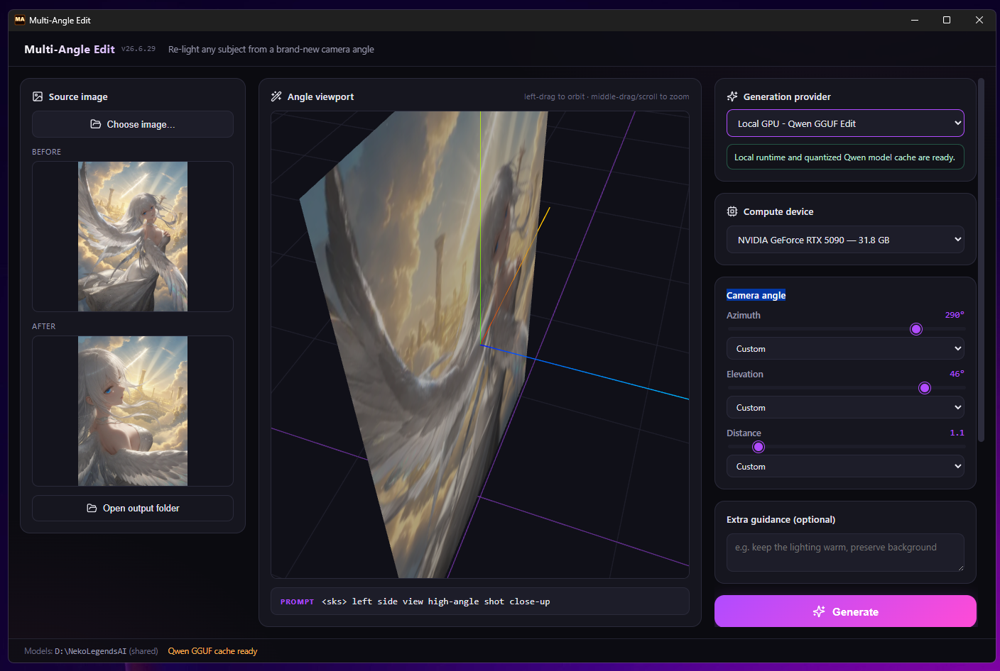

# Multi-Angle Edit

Multi-Angle Edit turns one source image into a new camera angle. Pick an image,
aim a simple 3D camera widget, and generate a new view such as front, side,
back, high-angle, close-up, or wide shot.

The app is designed for **Qwen-Image-Edit** with the
**Multiple-Angles LoRA** camera-angle add-on. It can also send edits through
[Venice Media Local](https://github.com/neko-legends/VeniceMediaLocal), but
other image-edit models may not follow the Qwen angle vocabulary as reliably.

Part of the Neko Legends / ForPublic suite. It shares the same
**NekoLegendsAI** model cache used by the other local AI tools, so Python wheels
and Hugging Face models can be reused instead of downloaded over and over.



## Quick Start

1. **Choose an image.** PNG, JPG, JPEG, and WebP are supported.
2. **Aim the camera.** Left-drag in the viewport to orbit. Middle-drag or scroll
   to zoom between close-up, medium, and wide shots. The sliders on the right
   stay in sync with the 3D view.
3. **Choose a provider.**
   - **Local GPU - Qwen GGUF Edit** runs Qwen-Image-Edit locally on your NVIDIA
     GPU and uses a VRAM-selected Unsloth GGUF quant.
   - **Online - Venice Media Local** sends the edit to Venice Media Local. This
     requires Venice Media Local to be open with its **AI Agent Control** /
     **AI Agent Remote Control** enabled.
4. **Add optional prompt additions.** Use the preset chips or type extra text
   such as `keep the original background`, `add warm rim light`, or
   `make the room moodier`.
5. **Generate.** The result is saved to the output folder next to the app.

## Which Provider Should I Use?

Use **Local GPU - Qwen GGUF Edit** when you want the intended Multi-Angle Edit
behavior. This is the path built around Qwen-Image-Edit 2511 plus
`fal/Qwen-Image-Edit-2511-Multiple-Angles-LoRA`.

Use **Online - Venice Media Local** when you want to try the same camera picker
with an edit model selected in Venice Media Local. Multi-Angle Edit talks to
Venice through Venice's local AI Agent Control API. If Venice is closed, or AI
Agent Control is disabled in Venice, this provider cannot work.

Venice may route the prompt to Qwen, Grok Imagine, GPT Image, or another
edit-capable model depending on what Venice Media Local exposes and what you
selected there. Non-Qwen models can still be useful, but they may interpret
camera-angle instructions differently and may ignore the Qwen `<sks>` trigger
token.

## Venice Media Local Setup

The Venice provider depends on
[Venice Media Local](https://github.com/neko-legends/VeniceMediaLocal).

1. Open Venice Media Local.
2. Enable **AI Agent Control** / **AI Agent Remote Control** inside Venice Media
   Local.
3. Select the edit or DiT model you want Venice to use.
4. Return to Multi-Angle Edit and choose **Online - Venice Media Local**.

When linked, Multi-Angle Edit reads Venice's local status and sends the edit to
Venice's `/api/v1/edit-image` endpoint. Recent Venice builds expose the selected
edit model through local state, so Multi-Angle Edit can use the same model you
picked in Venice.

## Local Qwen Requirements

- Windows.
- NVIDIA GPU for practical local generation. CPU fallback exists, but it is very
  slow.
- Python 3.10, 3.11, or 3.12 on PATH for the first-run environment bootstrap.
- Node.js 20+ and the Rust toolchain only if you are building from source.

The local path was built and tested around an RTX 5090 + RTX 3090 workstation.
It uses CUDA cu128 so both Blackwell and Ampere GPUs are covered.

## First Local Run

The first local generation can take a while. The app creates its own Python
environment, installs PyTorch, diffusers, and GGUF support, then downloads:

- Qwen-Image-Edit 2511 pipeline files.
- A VRAM-selected `unsloth/Qwen-Image-Edit-2511-GGUF` transformer quant.
- `fal/Qwen-Image-Edit-2511-Multiple-Angles-LoRA`.

The worker avoids the full 16-bit Qwen transformer shards by default. To force a
specific quant, set `MULTIANGLE_QWEN_GGUF_QUANT` to `Q8_0`, `Q6_K`, `Q5_K_M`,
`Q4_K_M`, `Q3_K_M`, or `Q2_K`.

## Shared Model Cache

Models and caches live in a visible shared folder, usually:

```text
D:\NekoLegendsAI\
  models\   Hugging Face model cache
  cache\    pip / uv / torch caches
  envs\
    multiangleedit\   this app's Python environment
```

The app discovers the shared store automatically and falls back to an app-local
store if needed. The resolved store path is shown in the app footer.

## Prompt Behavior

The angle picker creates a Qwen-style angle prompt like:

```text
<sks> right side view high-angle shot close-up
```

Multi-Angle Edit also adds a short preservation instruction so the model tries
to keep the original subject, outfit, materials, background, lighting direction,
color palette, and general style unless your prompt additions explicitly change
them.

## AI Agent Control

Multi-Angle Edit can expose its own local HTTP API so trusted tools such as
Codex, Claude Code, or other local agents can drive it. This is separate from
Venice Media Local's AI Agent Control.

Multi-Angle Edit's API:

- Off by default.
- Binds to `127.0.0.1`.
- Defaults to port `17339`.
- Can be enabled in the in-app **AI Agent Control** panel.
- Publishes status to `%APPDATA%\NekoLegends\agent-api-registry.json` for the
  Neko Legends Control Center.

Useful endpoints:

- `GET /health` - API status.
- `GET /openapi.json` - OpenAPI description.
- `GET /gpus` - detected GPUs.
- `GET /store` - shared NekoLegendsAI store info.
- `POST /generate` - run a local multi-angle edit.

Example `POST /generate` body:

```json
{
  "imagePath": "D:\\Images\\source.png",
  "anglePrompt": "<sks> right side view high-angle shot close-up",
  "deviceIndex": 0,
  "extraPrompt": "keep the original background",
  "outputDir": "D:\\Images\\out"
}
```

Agent note: if an agent wants to use the **Venice Media Local** provider, Venice
Media Local must also be open and its own AI Agent Control must be enabled.

## Development

```bash
npm install
npm run tauri:dev      # run the app in dev mode
npm run tauri:build    # build the Tauri app
npm run release:build  # publish release/portable and release/installer outputs
```

The Python worker lives at `python/multi_angle_worker.py` and is bundled as a
Tauri resource.

## License

MIT.
